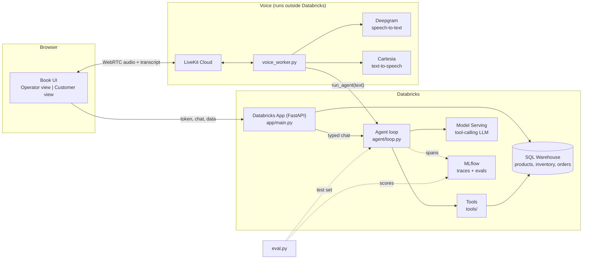

# Customer Supply Agent

A bilingual (English / Canadian French) voice and chat ordering agent for a food distributor, **built on Databricks**. A customer calls in, asks about stock, and places an order. An operator watches live inventory next to that customer's conversation, while every call is traced and regression-tested with MLflow.

## Highlights

- **Built on Databricks:** Databricks Apps (FastAPI) for the UI and API, SQL Warehouse + Delta tables for data, Model Serving for the LLM, MLflow for traces and evals.
- **Observability:** every LLM call, tool call and agent turn is traced in MLflow, tagged by session and persona.
- **Evals:** a regression suite (`eval.py`) scores replies for voice-safe formatting, brevity and correct stock numbers.
- **Monitoring:** the metrics to watch are defined below. Automated alerting is the next step (see [Monitoring](#monitoring)).
- **English and French:** speech recognition, spoken replies, fillers and greetings switch language per call.
- **Tone and voice settings:** three personas (warm, professional, upbeat) that change wording, speaking speed and emotion.
- **Two-page "book" UI:** operator view (inventory, reorder points) beside the customer view (live transcript, that caller's orders).

## Architecture




**A voice turn:** browser mic -> LiveKit Cloud -> `voice_worker.py` (Deepgram transcribes) -> `run_agent` -> model + tools + SQL -> reply -> Cartesia speaks it -> LiveKit -> browser. If the answer is slow, the worker says a short filler ("Hmm, let me check.") so there is no dead air. Typed chat uses the same `run_agent`, so both paths behave identically.

## Project structure

```
.
├── app.yaml               Databricks App config (env vars, start command)
├── config.py              env-driven settings
├── eval.py                MLflow regression eval
├── requirements.txt
├── voice_worker.py        LiveKit voice worker (run locally or on any host)
├── app/
│   ├── main.py            FastAPI: /api/chat, /api/token, /api/inventory, /api/orders, /api/reset
│   └── static/index.html  two-page book UI
├── agent/
│   ├── loop.py            run_agent: model + tool loop, MLflow tracing
│   ├── prompt.py          system prompt + personas
│   └── registry.py        list of tools
├── tools/                 check_inventory, draft_order, confirm_order, order_status
├── db/
│   └── client.py          all SQL goes through sql()
└── notebooks/             01_setup_data.sql, 04/05 migrations, 02_llm_smoke_test.py, 03_egress_test.py
```

## Languages and voice

| Setting | What it changes |
|---|---|
| **Language** (English / Français) | Deepgram transcription language, Cartesia speech language, greeting and filler phrases. Chosen when the call starts. |
| **Persona** (UI: Canadian · Warm & nice / Calm & professional / Upbeat & chatty) | The agent's name and personality in `agent/prompt.py`, plus speaking speed and Cartesia emotion settings in `voice_worker.py`. |
| **Voice** | The Cartesia voice ID in `VOICE_ID` (optional `VOICE_ID_FR`). The "Canadian" label is cosmetic: the actual accent is whichever voice you pick. |

Order numbers are 4 digits and are spoken digit by digit, never as one large number.

## Observability

`agent/loop.py` enables `mlflow.openai.autolog()` and wraps `run_agent` and each tool call with `@mlflow.trace`. Open **Experiments -> `/Shared/stockroom-voice` -> Traces** in Databricks to see, for any call:

- the full prompt, the model's raw output and any tool calls
- each tool's arguments, result and duration (AGENT and TOOL spans)
- latency and token counts per LLM call
- `session_id` and `persona` tags to find one customer's conversation

Set `MLFLOW_EXPERIMENT` to use a different experiment. Tracing is wrapped so a failure never breaks a live call.

## Evals

```
python eval.py
```

Resets demo data, runs five prompts (English and French stock questions, an over-limit order, an order-status query) through `run_agent`, and scores each with rule-based scorers:

| Scorer | Passes when |
|---|---|
| `no_leaks` | no raw tool syntax (`<function=`), markdown or bullets in a spoken reply |
| `short_enough` | three sentences or fewer |
| `has_expected` | the correct stock number appears (digits) |

Results appear in the same MLflow experiment under **Evaluation**. Run it after every prompt, model or tool change. Five cases is a smoke test: grow it toward 30 or more with bad transcripts, interruptions, out-of-stock and more French.

## Monitoring

**Status: metrics defined, automated alerting not yet built.** Traces already carry the data. The signals worth alerting on:

| Signal | Why it matters |
|---|---|
| Replies containing `<function` | the model is leaking tool syntax to callers (a bug we have already hit) |
| Tool error rate | SQL or schema problems, warehouse cold starts |
| p95 turn latency | silence on the phone; filler phrases only mask it |
| Orders drafted vs confirmed | conversion and read-back confusion |

Next step: a scheduled Databricks SQL query over the trace data with an alert on each signal. LiveKit Cloud's dashboard covers call-level data (sessions, connection issues).

## Setup

1. **Data.** Run `notebooks/01_setup_data.sql` in the Databricks SQL editor. (Upgrading older tables: run `04_` and `05_` instead.) Then grant the app's service principal access (see the commented `GRANT` lines in `01_`).
2. **Model.** Pick a chat endpoint from **Serving** and use its exact endpoint name as `MODEL_ENDPOINT`. Run `notebooks/02_llm_smoke_test.py` to confirm it makes real tool calls.
3. **Accounts.** Create free LiveKit Cloud, Deepgram and Cartesia accounts. Pick a Cartesia voice and copy its ID.
4. **App.** In `app.yaml` set `LIVEKIT_URL`, `LIVEKIT_API_KEY`, `LIVEKIT_API_SECRET` as plain `value:` entries (not `valueFrom`). Include `livekit-api` and `mlflow` in `requirements.txt`. Deploy from the workspace folder that holds your latest code.
5. **Worker.** From the repo root:
   ```
   python -m venv .venv && source .venv/bin/activate
   pip install livekit-agents livekit-plugins-deepgram livekit-plugins-cartesia \
               livekit-plugins-openai livekit-plugins-silero databricks-sdk python-dotenv "mlflow>=3.1"
   cp .env.example .env      # fill in every value
   python voice_worker.py dev
   ```
   Keep it running, open the app and click **Start call**.

Worker `.env`:

```
LIVEKIT_URL  LIVEKIT_API_KEY  LIVEKIT_API_SECRET
DEEPGRAM_API_KEY  CARTESIA_API_KEY  VOICE_ID  (optional VOICE_ID_FR)
DATABRICKS_HOST  DATABRICKS_TOKEN  DATABRICKS_WAREHOUSE_ID  MODEL_ENDPOINT
```

`DATABRICKS_WAREHOUSE_ID` is the real ID from the warehouse's connection details (last part of the HTTP path), not the app resource key.

## Known limits

- Language and persona are fixed when a call starts. Changing a dropdown mid-call has no effect.
- Replies are generated in full before speaking. Streaming model output into text-to-speech would cut most of the delay.
- Demo-grade state: sessions live in memory, order IDs are random 4-digit numbers, and `/api/reset` wipes all orders for everyone.
- The worker must be running to answer calls. Worker does not run inside Databricks.
- French quality depends on the Cartesia voice you choose.

## Credits

Built on ideas and starter work from [@datasciencemonkey](https://github.com/datasciencemonkey). Powered by Databricks, LiveKit, Deepgram, Cartesia and MLflow.
